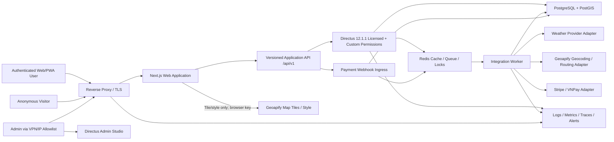
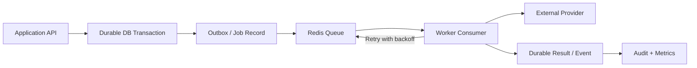
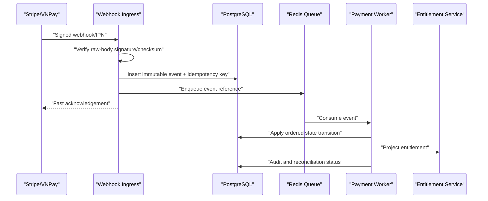

# System Architecture

## 1. Document control

| Field | Value |
|---|---|
| Version | 1.1 |
| Date | 2026-07-31 |
| Status | VERIFIED / PHASE_1 APPROVED |
| Owner | Product Owner / Technical Owner |
| Decisions | `ARCH-003..013`, `SEC-001..002`, `OPS-003`, `OPS-005..006`, `DATA-004`, `PRODUCT-012` |

## 2. Architecture goals

- Directus remains the primary backend, system of record, identity authority and Admin Studio.
- Frontend consumes the versioned public Application API; the only approved direct provider traffic is Geoapify tile/style loading under `ARCH-012`.
- Provider, payment and AI credentials/logic stay behind backend trust boundaries.
- Long-running, retry-heavy and scheduled work runs in a separate worker.
- Every business-critical state transition is durable, idempotent and auditable.
- Local development and future VPS deployment use the same containerized topology.
- Directus build baseline is exact version `12.1.1`, pinned by manifest digest according to `ARCH-011`; floating `latest` is forbidden.

## 3. Logical architecture

## 4. Component responsibilities

| Component | Owns | Must not own |
|---|---|---|
| Next.js web/PWA | Presentation, navigation, form UX, locale formatting, MapLibre rendering, approved Geoapify tile/style loading and permission UX | Authorization, quota, risk, route score, direct geocoding/routing/weather/payment/AI calls, server secrets or Directus schema knowledge |
| Application API | Public DTOs, validation, session boundary, authorization orchestration, entitlement/quota checks, structured errors | Long blocking jobs, provider-specific payload exposure or client-side trust |
| Directus | Users, roles/policies, business collections, content/translations, plans, rules, audit and workflows | Unbounded ingestion loops or queue semantics for critical background work |
| PostgreSQL + PostGIS | Durable system state, spatial data, event/usage ledger, migrations | Ephemeral cache or frontend access |
| Redis | Cache, queue, rate limiting, locks and short-lived session/job coordination | Authoritative subscription/payment state |
| Worker | Scheduled ingestion, route/weather evaluation, retries, reconciliation and provider adapters | Public browser API or Super Admin access |
| Reverse proxy | TLS termination, routing, security headers, request limits and Admin Studio network restriction | Business authorization |
| Observability stack | Sanitized logs, metrics, traces and alerts | Secrets, tokens, raw card data or unnecessary precise GPS |

## 5. Public API boundary

- Base contract: `/api/v1`.
- OpenAPI is the source of truth for request/response schemas.
- DTOs use stable public names and provider-neutral units/fields.
- Errors contain stable `code`, localized-display key/context, correlation ID and retryability; no stack trace.
- Mutating endpoints require authenticated session, CSRF/origin protection and idempotency where applicable.
- Directus generic REST/GraphQL routes are not exposed to the frontend product origin.
- Browser network allowlist permits Geoapify tile/style origins only; geocoding/routing calls remain backend-only.
- API deprecation requires a replacement, migration window and telemetry before removal.

## 6. Session and identity architecture

1. Browser posts login/registration/recovery credentials only to the same-origin Application API.
2. Application API delegates authentication to Directus.
3. Browser receives an opaque, random session handle in `Secure`, `HttpOnly`, `SameSite` cookie; it never receives refresh/static tokens.
4. Server-side session record maps to Directus identity/token metadata with encryption and expiry.
5. Every API request resolves the session and rechecks role/policy plus item ownership/entitlement.
6. Logout, password reset, account disable and security event revoke the session family.
7. Directus password-reset/email-verification query tokens are consumed only by redacted API endpoints, encrypted server-side and exchanged for short-lived opaque fragment handles under `SEC-009`/`SEC-010`.

State-changing requests additionally validate `Origin`/`Host` and use CSRF protection where SameSite behavior alone is insufficient.

Phase 3 implements this boundary as the thin TypeScript/Fastify service in [`../../apps/api`](../../apps/api). Its dedicated PostgreSQL role can access only `app_security` session/audit/auth-token objects; Directus tokens are encrypted at rest, transactional key rotation is available, and Redis is used for rate limiting rather than authoritative session validity. Runtime details and current residual gates are recorded in [`PHASE_3_RUNTIME_SECURITY.md`](PHASE_3_RUNTIME_SECURITY.md).

Directus identity-security changes are synchronized into the application-session boundary by an idempotent PostgreSQL trigger. Password, status, role, MFA-secret changes and user deletion revoke all active `app_security.sessions` for that user. Retention deletion is exposed only through a DB-owner function with validated cutoffs; the Application API role cannot execute it or delete audit events.

## 7. Background job architecture

- A durable database record/outbox is created before a critical job is acknowledged.
- Job payload references IDs; it does not duplicate full sensitive records.
- Each job has idempotency key, attempt count, timeout, backoff and dead-letter state.
- Worker leases/locks expire safely after crash.
- Payment, quota and entitlement mutations commit in database transactions.

## 8. Weather and routing adapters

- Internal interfaces normalize provider requests/responses.
- Provider keys, endpoints, timeout, quota and feature availability come from secret/config stores.
- Raw provider payload may be retained only when contract and debugging need permit it; normalized data is preferred.
- Adapter output includes provider, product/version, provider reference, `issued_at`, `valid_at`, `fetched_at`, units and confidence/freshness metadata.
- Circuit breaker and provider-specific rate limits prevent cascading failure.
- Route/risk adapter rejects or returns unknown for ETA beyond the Directus-published 72-hour operational horizon; day 4–7 data is outlook-only according to `DATA-004`.
- Geoapify Free is the selected map/geocoding/routing baseline under `ARCH-012`; full Vietnam fixtures and route objectives passed. Browser enforcement and account reconciliation remain assigned to Phase 9/13.
- WeatherAPI is the capability-bounded point-weather baseline under `ARCH-013`; current account coverage is 3 forecast days and day 4–7 remains disabled.

## 9. Payment architecture

- Browser redirect/Return URL is informational only.
- Stripe remains disabled until eligible merchant evidence exists.
- VNPay defaults to prepaid/manual renewal until unattended recurring is contractually proven.
- Reconciliation periodically compares provider and internal state.

## 10. Data ownership

| Domain | Authoritative store |
|---|---|
| Users, roles, policies | Directus/PostgreSQL |
| Plans, entitlements and quotas | Directus configuration + PostgreSQL usage/subscription ledger |
| Payment events/subscription projection | PostgreSQL; provider is external evidence, not authorization engine |
| Locations and route geometry | PostgreSQL + PostGIS |
| Weather normalized cache/history | PostgreSQL/Redis according to retention and provider terms |
| Risk rules/advisory/translations | Directus versioned collections |
| Jobs/retries | Durable DB job/outbox + Redis delivery queue |
| Audit | Directus audit plus application security/business audit tables/logs |

## 11. Degraded modes

| Failure | Required behavior |
|---|---|
| Weather provider timeout | Serve valid cached data with stale label within approved window, otherwise `unavailable`; never fabricate |
| Routing provider timeout | Keep existing saved route display if licensed; disable new evaluation/reroute and show retry state |
| Redis unavailable | Fail closed for quota/payment jobs requiring atomicity; cached reads fall back to database/provider within circuit limits |
| Worker unavailable | API accepts only jobs that have durable record; expose pending state and alert queue age |
| Payment provider unavailable | Do not grant Pro; preserve checkout attempt and retry/reconcile later |
| Directus Admin Studio unavailable | Product read flows may continue if API/database healthy; publishing/config changes pause |
| Database unavailable | Fail closed; no payment/quota mutation; readiness check removes instance from service |

## 12. Deployment portability

Local and future VPS environments share version-pinned container definitions for:

- Reverse proxy.
- Next.js web.
- Directus.
- Worker.
- PostgreSQL/PostGIS.
- Redis.
- Observability/export agents where selected.

Secrets and environment-specific endpoints are externalized. Production deployment cannot require editing source files or committing credentials.

## 13. Downstream implementation evidence

- Provider API-key bake-off and Vietnam fixtures are complete in Phase 1; later phases implement the approved adapters and degraded controls.
- Directus runtime/migration verification for the pinned `12.1.1` image in Phase 2; version/license pin itself is recorded in [DIRECTUS_BASELINE.md](DIRECTUS_BASELINE.md).
- Queue library/runtime selection and failure test.
- Session-store encryption/rotation implementation design.
- Concrete staging/production topology before Phase 13.
- Stripe/VNPay production merchant capability evidence before either adapter is enabled in Phase 10.
