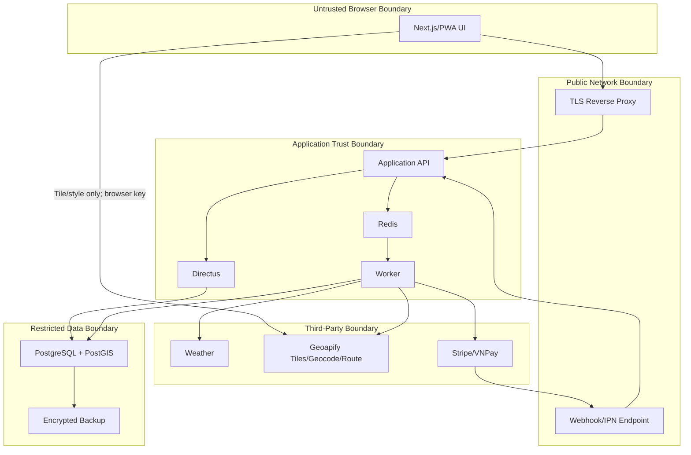
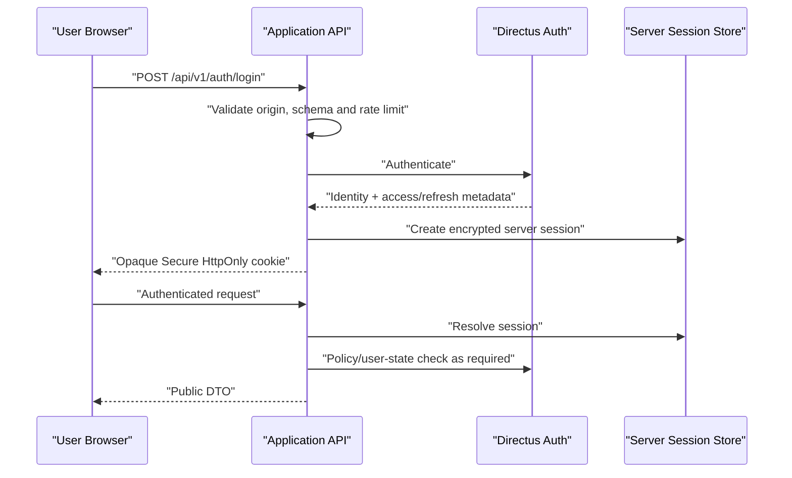
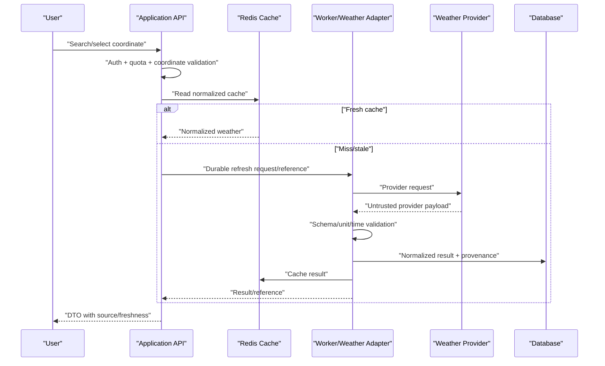
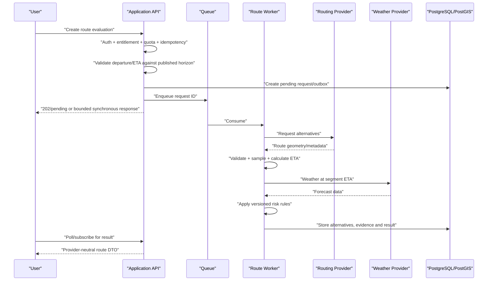
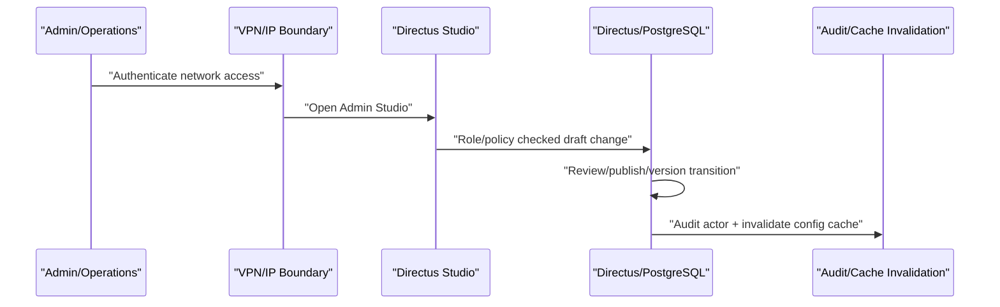

# Data Flow and Trust Boundaries

## 1. Trust boundaries

Browser, public network and all third-party responses are untrusted. Authentication, authorization and validation are repeated at the Application API/tool boundary even when Directus policies also apply. Direct Geoapify browser traffic is limited to tile/style resources; geocoding and routing remain behind the Application API.

## 2. Login/session flow

Sensitive values: credentials in transit, Directus tokens and server session material. Controls: TLS, rate limits, no credential logging, encrypted server-side token storage, cookie flags, CSRF/origin validation and session-family revoke.

## 3. Location weather flow

Precise GPS is transient unless the user explicitly saves a place/route. Generic logs avoid raw coordinates.

## 4. Route evaluation flow

Quota is consumed exactly once according to the approved policy even when the client retries. Route geometry is never invented when the provider returns no route.

Theo `DATA-004`, ETA tối đa 72 giờ mới được chạy route/risk scoring. Ngày 4–7 chỉ trả outlook; vượt horizon hoặc thiếu forecast coverage trả trạng thái rõ ràng và không tạo score giả.

## 5. Payment flow

1. User asks backend for available payment methods.
2. Backend validates market, currency, plan interval, provider status and merchant capability.
3. Backend creates checkout/order with an idempotency key.
4. User completes provider-hosted/tokenized flow.
5. Return URL only displays pending/result information.
6. Signed webhook/IPN creates a durable event.
7. Worker applies subscription transition and entitlement projection.
8. Reconciliation resolves delayed, missing or out-of-order events.

No browser-provided `success=true`, plan ID, price or provider status is trusted.

## 6. Admin publish flow

Risk rules, pricing and legal/advisory content require versioned publish evidence. Admin UI availability does not bypass API authorization.

## 7. Optional AI flow boundary

AI is not on the core critical path. If enabled later, the model receives a bounded prompt plus sanitized data returned by allowlisted backend tools. Each tool independently checks user, role, ownership, entitlement and field allowlist. Model output never directly executes database or payment mutations.
