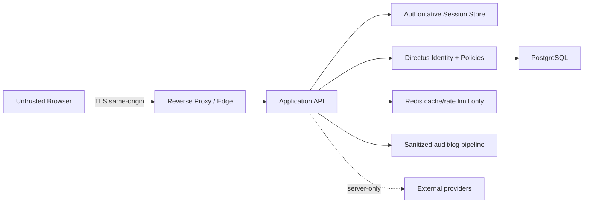
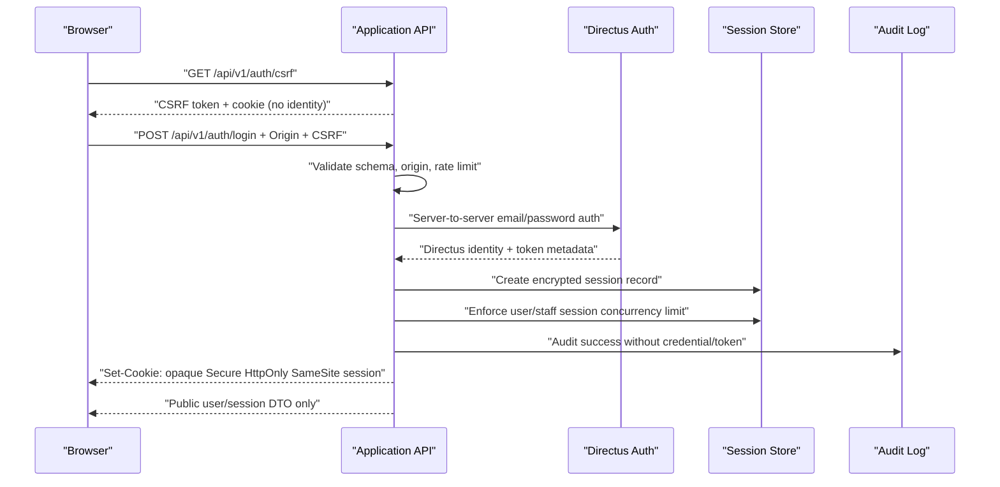
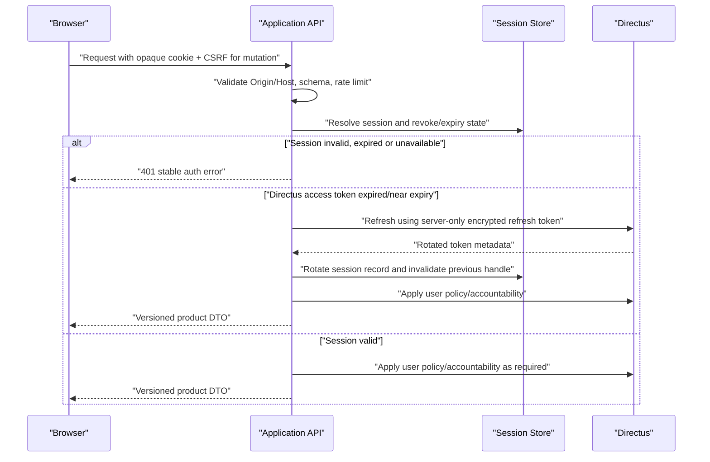

# Phase 3 Auth and Session Contract

**Trạng thái:** APPROVED (`SEC-007`)  
**Phase:** 3 — Identity, JWT, RBAC & Security  
**Decision baseline:** `SEC-004`, `SEC-005`, `SEC-006`, `SEC-009`, `SEC-010`, `DATA-006`, `PRODUCT-015`  
**Phạm vi:** Browser authentication, Application API session boundary và Directus identity handoff

Tài liệu này là contract kỹ thuật đầu tiên của Phase 3. Nó mô tả boundary và hành vi phải kiểm thử; chưa phải bằng chứng implementation. Không có giá trị nào trong tài liệu này được dùng để thay thế runtime configuration hoặc dữ liệu Directus đã publish.

## 1. Security invariants

- Browser chỉ gọi same-origin Application API `/api/v1`; không gọi Directus generic REST/GraphQL hoặc provider auth trực tiếp.
- Browser chỉ nhận opaque session cookie. Directus access/refresh token, service token và secret chỉ tồn tại phía server.
- Mọi request authenticated phải lấy user/accountability từ session server-side; không tin `user_id`, `role`, `plan`, `quota` hoặc entitlement do client gửi.
- Authorization, ownership, quota và entitlement được kiểm tra ở Application API/backend và policy Directus khi truy cập dữ liệu.
- Session lookup hoặc revalidation lỗi thì request nhạy cảm fail closed; không suy đoán user hoặc quyền từ cache/frontend.
- Logout, password reset, account disable, role/privilege change và incident response có thể revoke session family.
- Không ghi password, token, cookie, secret, card data, CVV hoặc precise GPS vào log.

## 2. Trust boundary



- Session state có nguồn sự thật durable ở backend; Redis chỉ là accelerator/rate-limit/coordination và không được cấp quyền khi state đã stale hoặc bị revoke.
- Directus là identity authority và policy engine; Application API là facade duy nhất cho product browser.
- Reverse proxy áp dụng TLS, security headers, request size limit và network restriction cho Admin Studio.
- External provider response là untrusted input, không tham gia quyết định identity hoặc entitlement.

## 3. Login sequence



Login failure returns a stable generic authentication error and does not reveal whether an email exists. Rate-limit and lockout behavior come from versioned runtime configuration; they are not hardcoded in the frontend.

## 4. Authenticated request and server-side refresh



Sensitive mutations additionally perform entitlement revalidation. If entitlement is missing or stale beyond the approved cache window, the API returns a retry/degraded error or denies the mutation; it never grants Pro from a client claim.

## 5. Logout and revocation

```mermaid
sequenceDiagram
    participant B as "Browser"
    participant A as "Application API"
    participant S as "Session Store"
    participant D as "Directus"
    participant L as "Audit Log"

    B->>A: "POST /api/v1/auth/logout + cookie + CSRF"
    A->>S: "Atomically revoke current session handle/family as configured"
    A->>D: "Revoke Directus refresh credential when supported"
    A->>L: "Audit actor, reason and correlation ID"
    A-->>B: "Expire cookie; return success"
```

Password reset, account disable, MFA recovery and privilege change must revoke the affected session family before returning success. A revoked session handle must not become valid again after deployment rollback.

## 6. Session record contract

| Field | Requirement | Sensitivity |
|---|---|---|
| `session_id_hash` | Hash of opaque cookie handle; never store raw handle | Secret-derived |
| `user_id` | Directus user identifier resolved server-side | Personal data |
| `session_family_id` | Groups rotations and incident revoke | Security metadata |
| `directus_access_token_ciphertext` | Encrypted at rest; server-only; TTL follows `SEC-004` | Secret |
| `directus_refresh_token_ciphertext` | Encrypted at rest; server-only; never returned to browser | Secret |
| `created_at`, `last_seen_at`, `expires_at` | UTC timestamps; expiry cannot exceed configured lifetime | Operational |
| `rotated_from` / `rotation_counter` | Prevents replay and session fixation | Security metadata |
| `revoked_at`, `revoke_reason` | Immutable revoke evidence | Audit metadata |
| `user_agent_hash`, `ip_prefix` | Optional abuse-detection metadata, minimized and retention-bound | Personal data |

Raw cookie handles, passwords, tokens and precise IP/GPS values are not persisted in logs. Session concurrency limits are loaded from approved runtime/Directus configuration: user maximum 5, staff/admin maximum 2. When the limit is reached, new login is denied until an existing session is explicitly revoked; no silent eviction is allowed by this contract.

## 7. Cookie, CSRF and CORS contract

- Session cookie name is runtime-configured and must use a `__Host-` prefix, `Secure`, `HttpOnly`, `Path=/`, no `Domain` and the approved `SameSite` value.
- CSRF token is separate from the session secret. Every state-changing request, including login, refresh and logout, sends a header token and passes same-origin `Origin`/`Host` validation.
- CORS is same-origin by default. Unknown origins, wildcard credentials and browser access to Directus generic routes are denied.
- Session handles, Directus tokens, password-reset tokens and email-verification tokens are never returned in API DTOs, browser storage or clean redirect URLs. The Directus one-time token is allowed only on the initial HTTPS consume request under `SEC-009`/`SEC-010`; the API redacts that request URL, stores the token encrypted server-side, immediately redirects to a query-free URL fragment containing an opaque short-lived handle and rejects expiry/replay.
- Error responses expose stable code, correlation ID and retryability only; no stack trace or internal collection/field names.

## 8. Configuration and evidence requirements

The implementation must load these values from validated environment/Directus configuration, with secret material injected at runtime:

- session cookie attributes and session-store encryption key;
- access-token TTL, session/refresh lifetime and concurrency limits;
- CSRF/origin allowlist and rate-limit policies;
- audit/security/billing retention periods;
- entitlement cache TTL and fail-closed behavior.

The first implementation evidence must prove:

1. Login, refresh, logout and revoke behavior with real local services.
2. Session fixation, refresh replay and stale-session denial tests.
3. Browser bundle/network/log scans with no Directus token or server secret.
4. Cookie, CSRF, CORS and generic-Directus-route denial tests.
5. Cross-user, public-role and session-concurrency negative tests.

## 9. Review result

Product Owner đã phê duyệt contract tại `SEC-007`. Approval này cho phép chuyển sang thiết kế role-policy-permission matrix; nó không đánh dấu bất kỳ acceptance criterion hoặc implementation evidence nào là verified.

## 10. Implementation status

Application API baseline đã được triển khai tại [`../../apps/api`](../../apps/api) và mô tả trong [`PHASE_3_RUNTIME_SECURITY.md`](PHASE_3_RUNTIME_SECURITY.md). Local live test đã chứng minh login, registration/email verification, password recovery, opaque cookie, refresh rotation/replay denial, logout revoke, CSRF denial, encrypted Directus tokens, sanitized audit, encryption-key rotation và API database least privilege.

Phase 3 default-deny chỉ cho traveler tự đọc identity `id`; vì vậy session DTO hiện không trả email/role/internal profile. API lấy `id/role` từ Directus token chỉ sau khi chính Directus chấp nhận token qua `/users/me`; browser không gửi hoặc xem token/claim này. Email/profile DTO chờ collection/field permission được duyệt và kiểm thử ở Phase 4.
