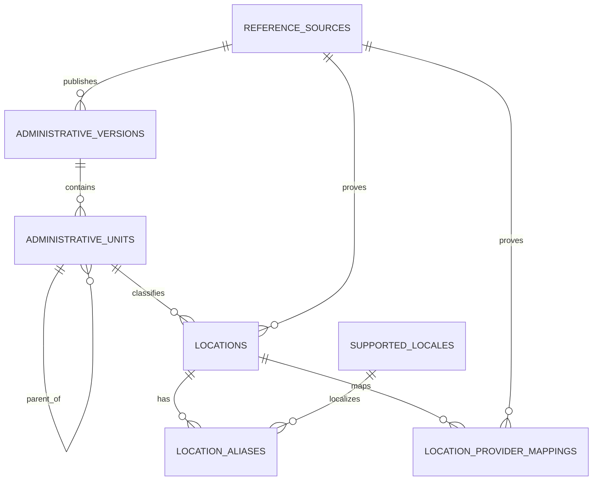
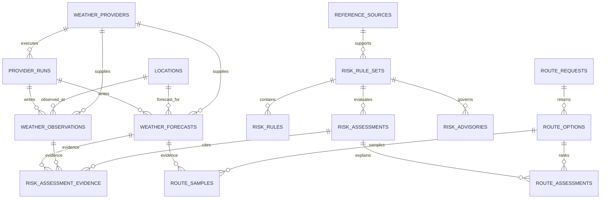
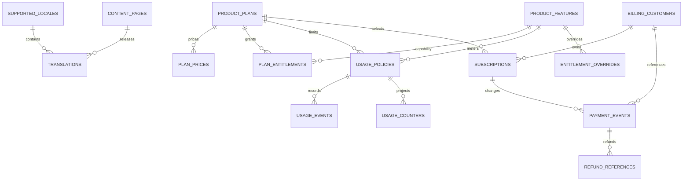
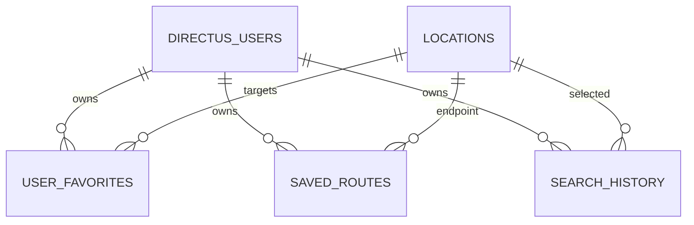

# Phase 4 ERD - Data Model & Governance

**Status:** IMPLEMENTED_LOCAL
**Decision baseline:** `DATA-005`, `DATA-006`, `DATA-007`, `SEC-008`, `ARCH-009`, `ARCH-015`, `PRODUCT-004`, `PRODUCT-005`, `PRODUCT-016`

ERD này mô tả schema nghiệp vụ thật trong `infra/postgres/init/004-create-phase4-data-model.sql`. Nó không chứa danh sách tỉnh/thành, quận/huyện, điểm du lịch, provider, weather hay payment giả.

## Location và địa giới hành chính

- `administrative_versions` tách từng lần công bố dữ liệu hành chính; không hardcode số tỉnh/thành.
- `administrative_units.parent_id` tạo cây country -> province/municipality -> district -> ward/commune. District và cấp thấp hơn là optional, nhưng schema hỗ trợ đầy đủ.
- Parent và child bắt buộc thuộc cùng một `administrative_version`.
- `locations` là điểm canonical dùng bởi sản phẩm; một location có thể gắn đơn vị hành chính, nguồn, alias và mapping provider.
- Chỉ import địa danh khi có `reference_sources`, version, checksum và quyền sử dụng được duyệt.

## Weather, risk và route

- Forecast truy vết được provider, provider run, parser version, issued time, valid interval, fetched time và expiry.
- Risk assessment truy vết được rule-set version và từng weather evidence record.
- Route chỉ lưu hình học do provider/trình xử lý thật tạo; migration và seed không tạo route giả.

## Content, product và billing

- Price chỉ là versioned provider reference; không có card number, CVV hay payment credential.
- `payment_events` và `usage_events` là ledger idempotent; identity fields và delete bị governance trigger bảo vệ.
- Entitlement/quota là backend truth, không dựa vào frontend claim.

## User-owned data

Mọi create/read/update/delete của traveler trên các collection này dùng `$CURRENT_USER`. Positive path và cross-user denial được test bằng hai user ephemeral thật; cleanup xác nhận còn 0 fixture.
