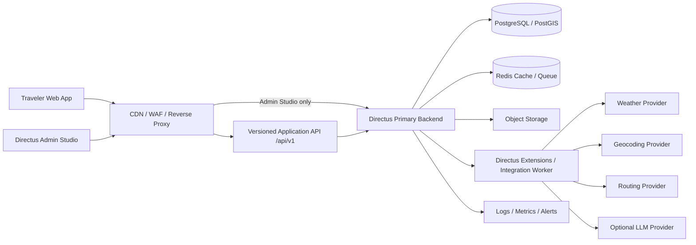

# Master Plan — Intelligent Weather-Aware Travel Assistant for Vietnam

## 1. Product vision

Xây dựng một nền tảng web giúp người đi du lịch tại Việt Nam đưa ra quyết định an toàn hơn dựa trên dữ liệu thời tiết hiện tại và dự báo từ nguồn có thật. Sản phẩm trực quan hóa thời tiết trên bản đồ, trình bày dự báo và xu hướng, đánh giá rủi ro theo địa điểm, phân tích thời tiết dọc tuyến đường và đề xuất tuyến an toàn hơn. Chatbot AI là tính năng tùy chọn, chỉ được triển khai sau khi nền tảng dữ liệu và bảo mật đã ổn định.

## 2. Product outcomes

Sản phẩm phải cung cấp được:

1. Bản đồ thời tiết tương tác trên lãnh thổ Việt Nam.
2. Thời tiết hiện tại và dự báo có nguồn, thời điểm cập nhật và độ mới rõ ràng.
3. Hiệu ứng bản đồ mưa, mây, nắng, gió và timeline forecast lấy từ dữ liệu provider thật.
4. Biểu đồ forecast/trend không gây hiểu nhầm về độ chính xác.
5. Phân loại rủi ro du lịch dựa trên rule set được quản trị và version hóa.
6. Route planner hỗ trợ Fastest, Shortest, Weather-safer và Balanced; lấy forecast tại ETA dọc tuyến.
7. Directus Admin Studio cho người có quyền quản lý địa điểm, rule, nội dung cảnh báo, provider, feature flag, product plan và dữ liệu vận hành.
8. Authentication bằng Directus, JWT/access token, refresh/revoke an toàn và phân quyền đúng vai trò.
9. Gói Free/Pro, subscription, entitlement và usage limit được enforcement ở backend.
10. Thanh toán qua provider được chọn, webhook xác thực, idempotency, refund/cancel và audit đầy đủ.
11. i18n Việt–Anh cho UI, content, risk advisory, Pro paywall, billing message và chatbot.
12. Audit trail, monitoring, backup, incident response và quy trình release phù hợp production.
13. Chatbot tùy chọn chỉ trả lời dựa trên dữ liệu được truy xuất và phải hiển thị thời điểm/nguồn dữ liệu.

## 3. Scope boundaries

### 3.1. In scope

- Web application responsive cho desktop và mobile.
- Directus làm backend trung tâm và system of record.
- PostgreSQL; cân nhắc PostGIS khi route/location query cần không gian.
- Tích hợp weather API và routing/geocoding API theo adapter.
- Cache, scheduled ingestion, retry, circuit breaker và provider observability.
- Config-driven risk engine.
- Public landing page; toàn bộ product experience yêu cầu đăng nhập; Admin Studio tách quyền.
- GPS current location và live-follow khi web/PWA đang hoạt động, có consent và privacy controls.
- Security, privacy, audit, test automation và production operations.

### 3.2. Out of scope mặc định

- Tự huấn luyện mô hình dự báo khí tượng thay thế nhà cung cấp nghiệp vụ.
- Tuyên bố bảo đảm an toàn tuyệt đối hoặc thay thế cảnh báo của cơ quan chức năng.
- Dự báo giả khi provider lỗi hoặc dữ liệu quá hạn.
- Booking khách sạn/vé hoặc marketplace trong MVP.
- Tự lưu dữ liệu thẻ hoặc xử lý card number trong hệ thống.
- Chatbot tự suy diễn số liệu thời tiết không có trong context.
- Multi-tenant SaaS, native mobile app và offline navigation nếu chưa được duyệt riêng.
- Background GPS/turn-by-turn liên tục khi browser đóng hoặc màn hình khóa.

## 4. Nguyên tắc không hardcode và không làm giả dữ liệu

| Loại thông tin | Nơi quản lý bắt buộc | Không được làm |
|---|---|---|
| Địa điểm, tọa độ, loại điểm | Directus collections | Mảng địa điểm viết cứng trong frontend/backend |
| Ngưỡng và công thức rủi ro | Versioned risk rule collections | `if rain > 7.5` rải rác trong code |
| Trọng số route score | Versioned configuration | Hằng số không có nguồn gốc/approval |
| Provider và endpoint | Environment + provider registry | URL/key đặt trong source code |
| Secret/API key/JWT secret | Secret manager hoặc protected environment | Commit vào Git hoặc lưu plaintext trong collection |
| Nội dung cảnh báo | Directus content collections, hỗ trợ i18n | Chuỗi cảnh báo viết cứng trong JavaScript |
| Feature flag | Directus/config service | Bật tắt bằng sửa code |
| Product plan/feature/limit | Directus product collections | Gating chỉ ở frontend |
| Subscription/entitlement | Billing webhook + Directus records | Tin JWT claim cũ là nguồn sự thật duy nhất |
| UI translation | Locale catalog + Directus translated content | Nối chuỗi thủ công hoặc dịch ngầm bằng code |
| Dữ liệu production | Provider response có provenance | Mock/fallback được trình bày như dữ liệu thật |
| Test fixtures | Test-only, được gắn nhãn rõ | Đẩy fixture sang production |
| Seed/reference data | Versioned idempotent seed theo environment | Seed ghi đè production hoặc tạo duplicate |
| Account/service identity | Directus + secure provisioning/secret manager | User/password/static token hardcode trong seed/frontend |

Khi dữ liệu thật không khả dụng, UI phải hiển thị trạng thái `unavailable`, `stale` hoặc `provider_error`; không tự tạo giá trị thay thế.

## 5. Kiến trúc mục tiêu

### 5.1. Directus chịu trách nhiệm

- Users, authentication, access token/JWT lifecycle và service accounts.
- Roles, policies, collection/field/item permissions.
- Admin Studio cho business/operations.
- REST/GraphQL API và realtime nếu được duyệt.
- Dữ liệu cấu hình, dữ liệu chuẩn hóa và provenance.
- Activity/audit, revisions, workflow và approval.
- Flow orchestration phù hợp với tác vụ ngắn và không quá nặng.
- Custom endpoint/hook cho nghiệp vụ cần kiểm soát quyền trong Directus.

### 5.1.1. Frontend/API boundary

- Frontend chỉ gọi versioned Application API và nhận public DTO; không gọi generic Directus collection endpoints/GraphQL trực tiếp.
- Application API được triển khai bằng Directus custom endpoints hoặc thin BFF/gateway theo ADR; không tạo system of record thứ hai.
- DTO không expose collection name, internal field, provider payload, secret, raw stack trace hoặc schema chi tiết không cần thiết.
- Backend xử lý auth, policy, entitlement, quota, validation, localization content selection, weather/risk/route/payment/AI logic và audit.
- Frontend chỉ xử lý presentation, navigation, accessibility, form state và render response/error có cấu trúc.
- API contract phải có versioning, OpenAPI/schema, correlation ID, error catalogue và backward-compatibility policy.

### 5.2. Integration worker hoặc extension chịu trách nhiệm

- Gọi weather/routing/geocoding provider bằng adapter.
- Retry có backoff, timeout, circuit breaker và idempotency.
- Scheduled ingestion và chuẩn hóa response.
- Tính route sample/ETA và risk assessment có thể tái hiện.
- Không được bỏ qua Directus permission hoặc ghi trực tiếp DB ngoài contract đã duyệt.

Quyết định dùng Directus extension, worker riêng hay kết hợp phải được chốt ở Phase 1. Directus vẫn là backend chính và system of record trong mọi phương án.

## 6. Environments và deployment topology

Tối thiểu phải có:

- `local`: phát triển cá nhân, test data riêng.
- `development`: tích hợp liên tục.
- `staging`: cấu hình gần production, dùng để UAT và security test.
- `production`: dữ liệu thật, quyền truy cập hạn chế, backup và monitoring đầy đủ.

Không dùng chung database, secret, bucket hoặc service account giữa staging và production. Phiên bản Directus và container image phải được pin; không deploy tag `latest`.

## 7. Identity, JWT và access control baseline

Các thông số cụ thể phải được chốt trong Phase 3, nhưng baseline bắt buộc gồm:

- Access token sống ngắn; refresh/revoke được quản lý an toàn.
- Không lưu refresh token trong `localStorage`.
- Admin bắt buộc MFA/2FA nếu môi trường hỗ trợ.
- Tách Super Admin khỏi tài khoản vận hành hàng ngày.
- Public role mặc định deny; chỉ mở published marketing content, pricing summary, legal content và locale resources cần cho landing page.
- Service account có policy tối thiểu, không dùng tài khoản admin cho worker.
- AI orchestration chỉ chạy backend; frontend không chứa LLM key, system credential hoặc static service token.
- AI tool authorize độc lập theo user, Directus policy và entitlement; model output không phải authorization decision.
- CORS allowlist, CSP, TLS, secure headers và rate limiting.
- Brute-force protection, lockout/throttling và log sự kiện đăng nhập.
- Rotation cho secret/token và quy trình thu hồi khi có sự cố.

### 7.1. Role model dự kiến

| Role | Mục đích | Quyền nguyên tắc |
|---|---|---|
| Super Admin | Khôi phục/quản trị tối cao | Break-glass, không dùng hàng ngày |
| Platform Admin | Cấu hình hệ thống được ủy quyền | Không mặc định có quyền xem secret |
| Weather Operations | Theo dõi provider, ingestion, dữ liệu lỗi | Không quản lý user/policy |
| Risk Analyst | Soạn và đề xuất rule set | Cần approval trước publish |
| Content Editor | Quản lý nội dung cảnh báo/i18n | Không sửa rule hoặc security config |
| Product/Billing Admin | Quản lý plan, entitlement, promo và billing state | Không xem payment secret/card data |
| Support/Auditor | Tra cứu sự cố/audit | Read-only có giới hạn PII |
| Integration Service | Worker/automation | Chỉ collection/action cần thiết |
| Registered Traveler | Dùng map/weather/search/route theo entitlement Free/Pro | Chỉ dữ liệu của chính mình và API được cấp |
| Public | Chỉ landing page | Marketing/pricing/legal/locale read-only tối thiểu |

## 8. Data domains dự kiến

Tên collection cuối cùng được chốt ở Phase 4. Các domain bắt buộc:

- Location catalog và administrative versioning.
- Weather providers, provider runs và health status.
- Current observations và forecasts có `issued_at`, `valid_at`, `fetched_at`, `expires_at`, source và quality status.
- Risk rule sets, rules, approval history và effective period.
- Risk assessments và explanation/evidence.
- Route requests, alternatives, sample points, ETA weather và route score.
- Advisory content, translations và legal disclaimer.
- App settings, feature flags và non-secret provider configuration.
- Audit/business events và retention metadata.
- Product plans, feature catalog, entitlement rules và usage limit policy.
- Billing customers, subscriptions, payment events, invoices/refunds reference và webhook idempotency records.
- Locale catalog, translated content, currency/number/date formatting policy.
- Optional chat sessions/messages với retention và consent riêng.

Billing provider là system of record cho payment instrument và charge status; Directus lưu business subscription state, provider references, webhook evidence và entitlement projection. Không lưu card number/CVV.

## 9. Weather data quality contract

Mọi record thời tiết phải cho biết:

- Provider và provider record/request reference.
- Tọa độ/provider location mapping.
- Đơn vị gốc và đơn vị chuẩn hóa.
- Thời điểm phát hành forecast và thời điểm forecast có hiệu lực.
- Thời điểm hệ thống lấy dữ liệu.
- TTL/độ mới và trạng thái stale.
- Phiên bản parser/normalizer.
- Quality flag, missing fields và lỗi provider.

Không trộn observation với forecast hoặc forecast của các lần phát hành khác nhau mà không giữ provenance.

## 10. Risk engine baseline

Risk engine là rule-based và config-driven:

- Rule set có version, trạng thái draft/review/approved/published/retired.
- Rule có nguồn tham khảo, đơn vị, phạm vi địa lý, loại hình du lịch và khoảng hiệu lực.
- Kết quả lưu rule version, weather evidence và explanation.
- Khi thiếu dữ liệu quan trọng, kết quả là `unknown/insufficient_data`, không tự gán `safe`.
- Rule thay đổi phải chạy regression test trên bộ scenario đã duyệt.
- UI luôn hiển thị đây là hỗ trợ quyết định, không phải bảo đảm an toàn.

## 11. Route safety baseline

Route planner phải:

- Lấy route alternatives từ provider thật.
- Chia tuyến thành sample theo khoảng cách/thời gian cấu hình được.
- Ước tính ETA tại từng sample.
- Dùng forecast phù hợp với ETA, không mặc định dùng weather hiện tại.
- Tính risk từng đoạn và route score bằng công thức version hóa.
- Xếp hạng Fastest, Shortest, Weather-safer và Balanced trong tập alternatives thực tế provider trả về.
- Hỗ trợ GPS origin/live progress/reroute theo `PRODUCT-008`, nhưng không lưu continuous location mặc định.
- Hiển thị lý do đề xuất, dữ liệu thiếu, tuổi forecast và provider.
- Không gọi một tuyến là “an toàn tuyệt đối”; dùng “rủi ro thời tiết thấp hơn theo dữ liệu hiện có”.

## 12. Monetization and Pro baseline

Pro là một product capability, không phải CSS paywall. Mọi giới hạn phải được enforcement ở Directus API/extension/worker.

- Plan catalog MVP chỉ gồm Free và Pro theo `PRODUCT-001`; tên, giá, currency, billing interval và benefit lấy từ cấu hình quản trị.
- Feature key ổn định, entitlement có effective period và subscription state.
- Usage event có user/account, feature key, request id, timestamp, outcome và source; không đếm request thất bại theo policy chưa được duyệt.
- Counter phải atomic, idempotent và chống race condition giữa nhiều request/device.
- Frontend chỉ hiển thị entitlement từ backend; không được tự mở khóa Pro.
- Subscription state xử lý active, trialing, past_due, canceled, expired, paused/refunded theo provider contract.
- Webhook phải verify signature, chống replay, idempotent và ghi audit.
- Cancel/refund/downgrade phải có hiệu lực và grace period được cấu hình; không tự đoán trạng thái từ thanh toán phía client.
- Pro benefit có thể gồm nhiều lượt search, route evaluation, forecast detail, saved locations, advanced trend và chatbot quota; danh sách cuối cùng phải do bạn chốt.

## 13. i18n baseline

- UI dùng translation key ổn định cho `vi` và `en`, không hardcode câu hiển thị trong component.
- Directus translated content quản lý location description, risk advisory, paywall copy, legal text và email template.
- Locale được xác định theo user preference, URL/cookie hoặc `Accept-Language` theo decision; luôn có fallback rõ ràng.
- Dùng ICU pluralization và formatter cho số, ngày, giờ, timezone, tiền tệ và quota.
- Translation missing phải có telemetry/QA; không hiển thị key kỹ thuật cho người dùng.
- Risk level và legal disclaimer phải có bản dịch được duyệt, không dịch tự động trong runtime production.
- Chatbot nhận locale và phải trả lời đúng ngôn ngữ đã chọn, nhưng số liệu/units vẫn theo product setting.

## 14. Optional AI chatbot baseline

Chatbot chỉ được bật khi Phase 5–9 đã VERIFIED. Chatbot phải:

- Gọi tool/API nội bộ để lấy weather/risk/route data, không tự bịa số.
- Tool được allowlist, giới hạn field/query/result và tự kiểm tra Directus accountability; không cho AI query DB/GraphQL tùy ý.
- Model không nhận JWT, refresh token, secret, raw user table hoặc admin/service credential.
- Trích nguồn và thời điểm cập nhật trong câu trả lời.
- Từ chối hoặc cảnh báo khi dữ liệu stale/missing.
- Có prompt/version, safety policy, rate limit, abuse monitoring và cost cap.
- Không được có quyền admin hoặc truy cập collection ngoài nhu cầu.
- Có cơ chế tắt ngay bằng feature flag.

## 15. Production non-functional requirements

Các con số cuối cùng phải được duyệt ở Phase 1:

- Availability/SLO và latency cho public API.
- Data freshness cho current weather và forecast.
- RPO/RTO, backup frequency và restore test.
- Maximum acceptable provider failure rate.
- Rate limit theo IP/user/service account.
- Retention cho weather, route, audit và chat data.
- Accessibility target, browser support và mobile performance budget.
- Logging không lộ token, secret hoặc PII.

## 16. Global Definition of Done

Một feature hoặc phase chỉ được coi là `VERIFIED` khi có đủ:

1. Decision Gate được chốt và ghi Decision ID.
2. Code review hoàn tất, không còn issue severity cao.
3. Unit, integration và contract tests pass.
4. Security checks phù hợp với mức rủi ro pass.
5. API/schema/config migration được version hóa.
6. Không có secret hoặc dữ liệu giả trong production path.
7. Tài liệu vận hành và rollback được cập nhật.
8. Evidence có đường dẫn commit, test report và môi trường xác minh.
9. Acceptance criteria được Product Owner hoặc người được ủy quyền duyệt.
10. Seed/migration chạy idempotent; production path không chứa demo account, fake data hoặc credential hardcode.

## 17. Phase strategy

### MVP bắt buộc

Phase 0–10, 12–14. Monetization/i18n là core business capability; chatbot không nằm trong critical path.

Kế hoạch thực thi theo deadline 3 tháng được quản lý tại [DELIVERY_ROADMAP_3_MONTHS.md](DELIVERY_ROADMAP_3_MONTHS.md). Các phase là quality gate và domain scope, không có nghĩa mọi công việc phải chạy tuần tự. Chỉ các hạng mục có dependency đã nêu mới được phép chạy song song.

### Optional

Phase 11 — AI chatbot. Chỉ thực hiện khi không làm chậm security, monetization, quality hoặc deployment.

## 18. Change control

Mọi thay đổi làm ảnh hưởng product outcome, provider, auth model, data retention, deployment topology hoặc risk logic phải:

1. Tạo Decision ID/ADR.
2. Phân tích ảnh hưởng security, data migration và chi phí.
3. Cập nhật phase liên quan trước khi code.
4. Có phương án rollback.

## 19. Official Directus references

- Access control: https://directus.com/docs/guides/auth/access-control
- Tokens and cookies: https://directus.com/docs/guides/auth/tokens-cookies
- Security best practices: https://directus.com/docs/guides/security/best-practices
- Security limits configuration: https://directus.com/docs/configuration/security-limits
- Authentication API: https://directus.com/docs/api/authentication
- Flows: https://directus.com/docs/guides/flows
- API extensions: https://directus.com/docs/guides/extensions/api-extensions
- Self-hosting: https://directus.com/docs/self-hosting/overview
- Metrics: https://directus.com/docs/configuration/metrics
- Logging: https://directus.com/docs/configuration/logging
- Health checks: https://directus.com/docs/configuration/healthcheck

Các URL trên là tài liệu tham khảo; phiên bản Directus, license và cấu hình thực tế phải được xác minh, pin và ghi quyết định trước khi triển khai.
